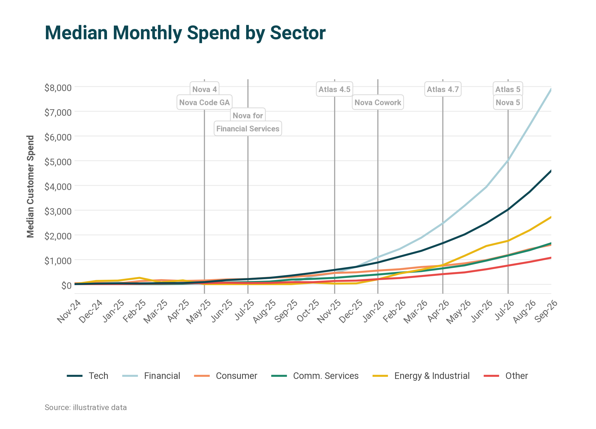
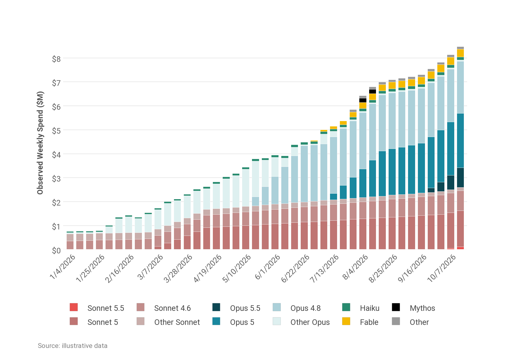
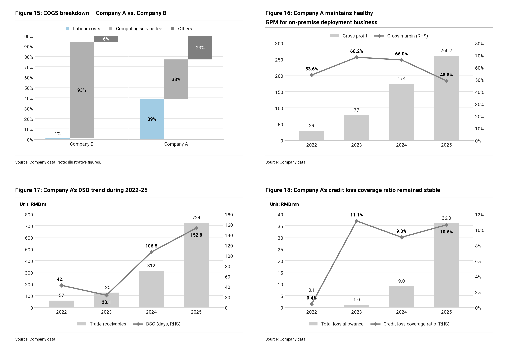
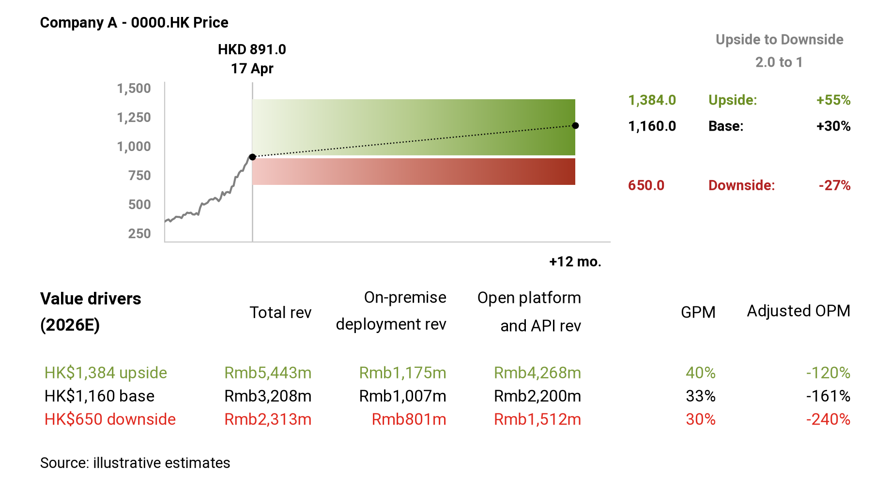
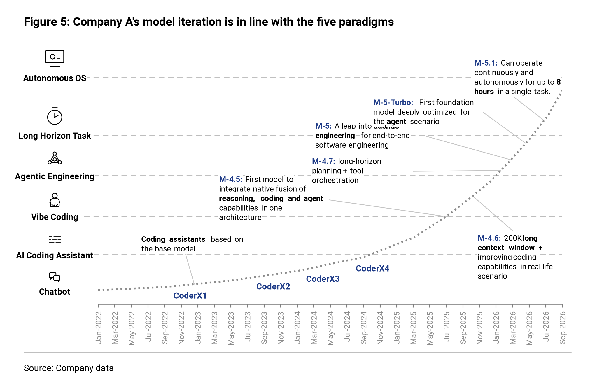
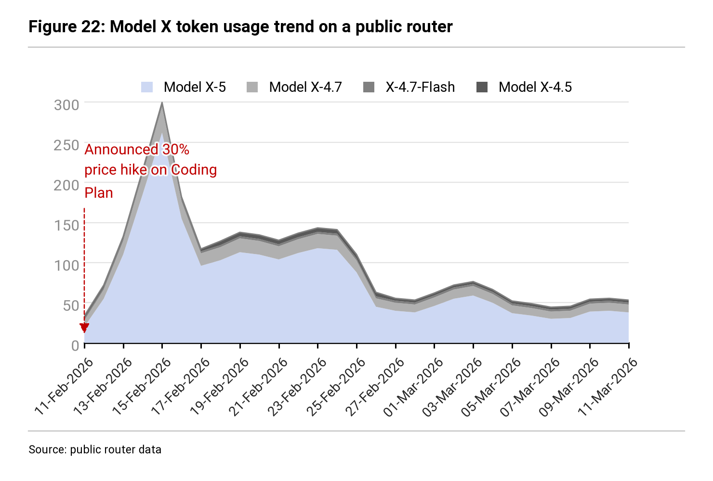

# insight-charts 研报级图表

让智能体画出「一眼能读出结论」的图。一个通用的 Agent Skill，同时打包成 Claude Code 插件和 DeepSeek Harness 插件。

- **两套主题**：`teal` 深青（数据展示型），`mono` 灰阶加单色高亮（论证型）。
- **七个画法**：只依赖 matplotlib，用 JSON 规格或 Python 调用。
- **一套写作规则**：什么时候放图、标题怎么写、图边上写什么。

| | |
|---|---|
|  带事件分隔线的趋势图 |  按家族配色的堆叠柱 |
|  多图联排 |  情景区间图加驱动因素表 |
|  能力阶梯图 |  突出一层的堆叠面积图 |

图中数据均为示意。

## 安装

前提：Python 3.9 以上，`pip install matplotlib`。要显示中文，系统里需要有 Noto Sans SC、思源黑体或微软雅黑之一。

### Claude Code

```bash
/plugin marketplace add Leon-S-7211/insight-charts
/plugin install insight-charts@insight-charts-marketplace
```

或者不走插件，直接复制技能目录：

```bash
cp -r skills/insight-charts ~/.claude/skills/
```

### DeepSeek Harness

```bash
dsh plugin --profile web add github:Leon-S-7211/insight-charts#<commit>
```

把 `<commit>` 换成本仓库最新的提交号。npm 包 `dsh-plugin-insight-charts` 尚未发布，发布后可以直接按包名安装。

或者作为普通技能复制（社区文档给出的两个位置，任选其一）：

```bash
cp -r skills/insight-charts ~/.deepseek/skills/
cp -r skills/insight-charts <项目目录>/.agents/skills/
```

### 其他支持 SKILL.md 的智能体

把 `skills/insight-charts/` 整个目录放进它的技能目录即可。目录是自包含的，不依赖本仓库其他文件。

## 用法

装好后直接对智能体说需求，例如：

> 用 insight-charts 把这份月度数据画成带事件分隔线的趋势图，标出三次模型发布。

> 这一节讲应收质量，帮我配一组四联图，标题写成结论。

也可以不经过智能体，直接出图：

```bash
cd skills/insight-charts
python scripts/insight_charts.py examples/trend_events.json -o out.png
python scripts/demo.py          # 重新生成全部示例
```

## 目录

```
skills/insight-charts/
  SKILL.md                    技能入口：流程、选图表、调用方法、自查清单
  references/recipes.md       七个画法的适用场景与参数
  references/style-tokens.md  色值、字号、版式
  references/writing-rhythm.md 放图时机与标题写法
  scripts/insight_charts.py   绘图库与命令行入口
  scripts/demo.py             示例生成器
  examples/*.json             规格样例
  assets/*.png                成品图
.claude-plugin/               Claude Code 插件与市场清单
package.json, cordis.patch.yml, index.js, locale/, icon.svg   DeepSeek Harness 插件
```

## 说明

- 风格参考了海外另类数据商的数据简报和卖方研究报告的图表习惯，本仓库不包含任何第三方的标志、水印或数据。
- DeepSeek Harness 的清单格式依据社区公开插件的写法整理，尚未在真实的 DSH 环境里安装验证。

## 许可

MIT
