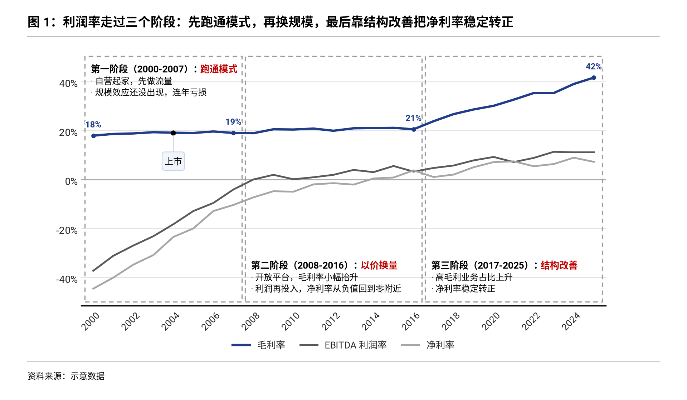
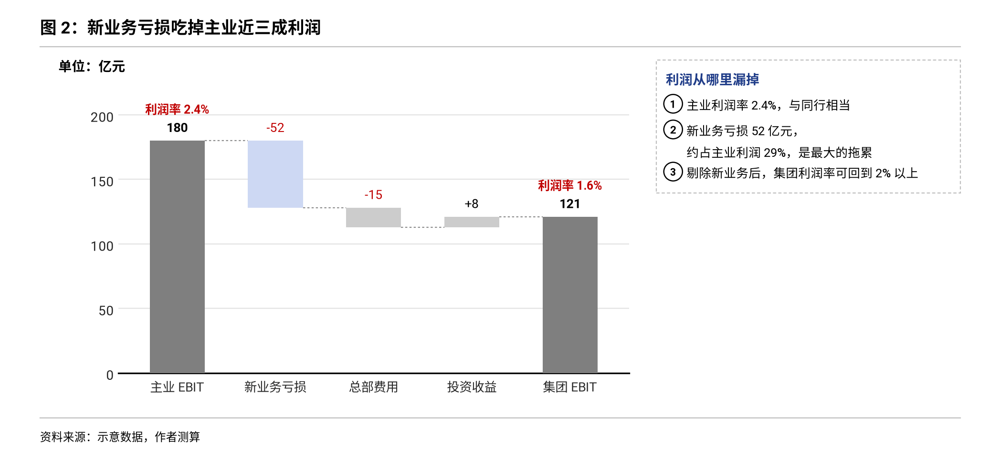
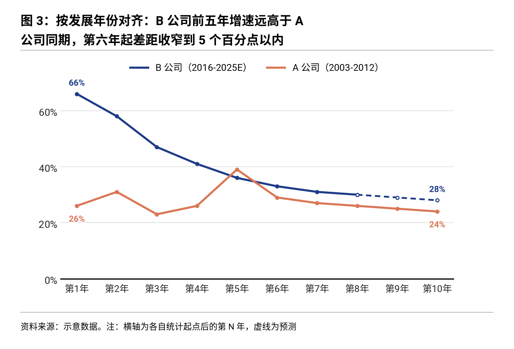
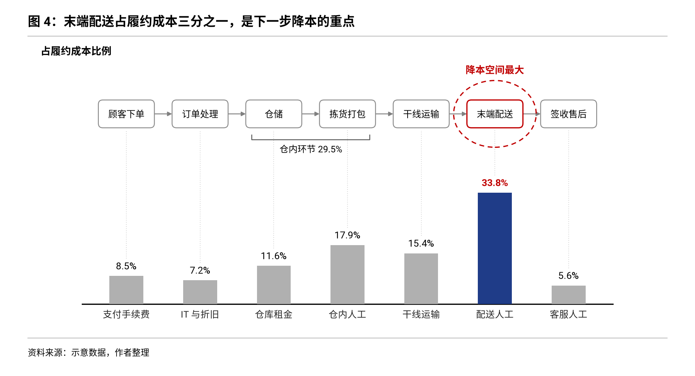
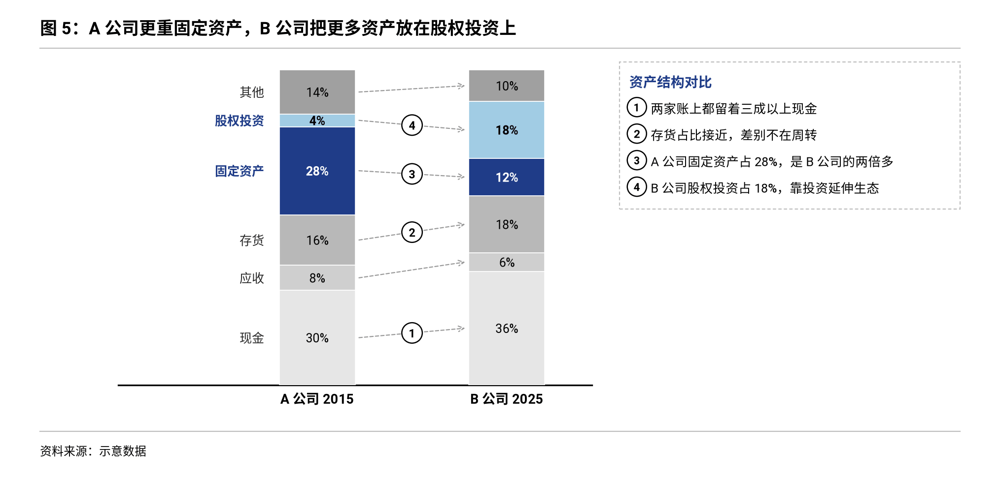
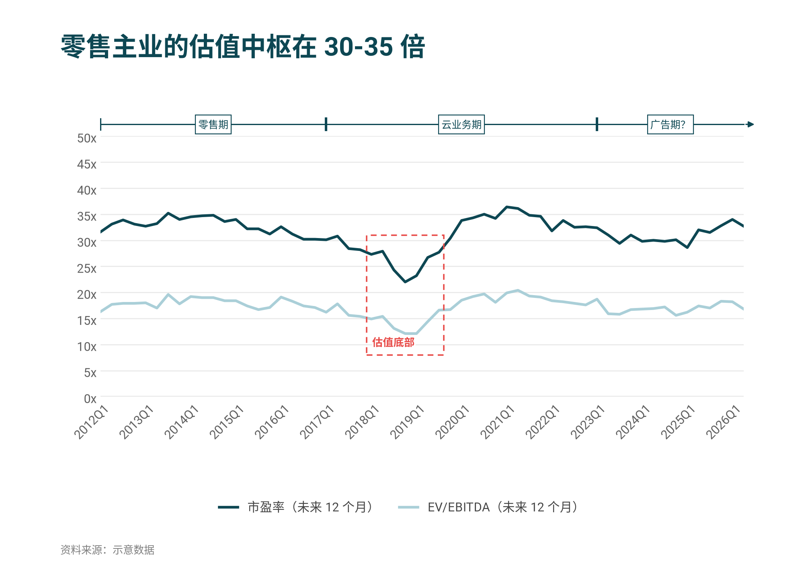
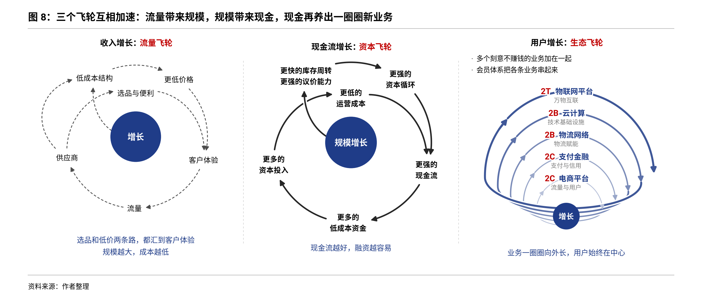
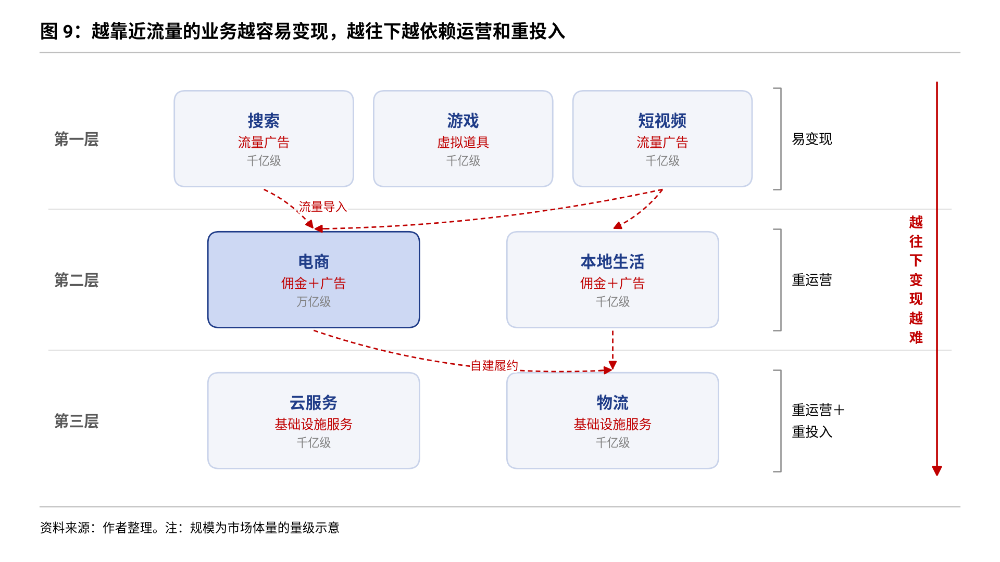
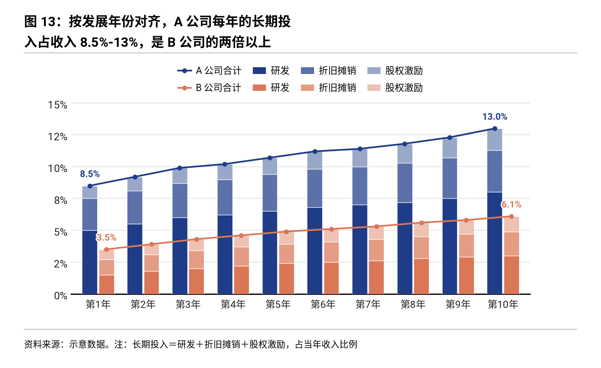
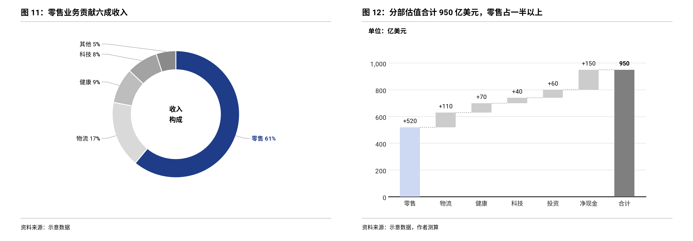

# insight-charts 研报级图表

让智能体画出「一眼能读出结论」的图。一个通用的 Agent Skill，同时打包成 Claude Code 插件和 DeepSeek Harness 插件。

- **两套主题**：`teal` 深青（数据展示型），`mono` 灰阶加单色高亮（论证型）。
- **十六个画法**：只依赖 matplotlib，用 JSON 规格或 Python 调用。
- **一组强调记号**：虚线框、红叉、贴线小牌、编号圆点、时代条、旁注栏，大多数画法通用。
- **一套写作规则**：什么时候放图、标题怎么写、一页怎么排、强调怎么用。

| | |
|---|---|
|  带事件分隔线的趋势图 |  按家族配色的堆叠柱 |
|  多图联排 |  情景区间图加驱动因素表 |
|  能力阶梯图 |  突出一层的堆叠面积图 |
|  分阶段趋势图 |  拆分瀑布图加旁注 |
|  按发展年份对齐 |  流程加成本柱 |
|  结构对比加编号旁注 |  时代条加虚线框 |
|  飞轮图 |  分层图 |
|  拆分加总和线 |  环形构成图加分部估值 |

图中数据均为示意。

## 安装

前提：Python 3.9 以上，`pip install matplotlib`。要显示中文，系统里需要有 Noto Sans SC、思源黑体或微软雅黑之一。

### Claude Code

```bash
/plugin marketplace add Leon-S-7211/insight-charts
/plugin install insight-charts@insight-charts-marketplace
```

或者不走插件，直接复制技能目录：

```bash
cp -r skills/insight-charts ~/.claude/skills/
```

### DeepSeek Harness

```bash
dsh plugin --profile web add dsh-plugin-insight-charts
```

`web` 换成你实际使用的配置名，比如 `tui`、`headless`。DSH 桌面版请用应用内的插件管理安装，命令行装进 `web` 配置的插件不会出现在桌面版里。

也可以直接从 GitHub 安装，把 `<commit>` 换成本仓库最新的提交号：

```bash
dsh plugin --profile web add github:Leon-S-7211/insight-charts#<commit>
```

或者不装插件，只把技能目录复制到 DSH 会扫描的位置，任选其一：

```bash
cp -r skills/insight-charts ~/.dsh/skills/              # 对所有项目生效
cp -r skills/insight-charts <项目目录>/.dsh/skills/       # 只对这个项目生效
```

`~/.agents/skills/` 和 `<项目目录>/.agents/skills/` 同样会被扫描。

### 其他支持 SKILL.md 的智能体

把 `skills/insight-charts/` 整个目录放进它的技能目录即可。目录是自包含的，不依赖本仓库其他文件。

## 用法

### 一条命令调用

在输入框里打 `/insight-charts`，后面接你的需求：

```
/insight-charts 把这份月度数据画成带事件分隔线的趋势图，标出三次模型发布
/insight-charts 这一节讲应收质量，配一组四联图，标题写成结论
```

- **DeepSeek Harness**：这一行会让 DSH 把整份技能说明直接交给模型，模型按规范出图，已在 DSH 0.2.2-rc.1 上实测。网页版里打 `/` 会弹出技能菜单，可以直接选。
- **Claude Code**：装成插件后命令带插件前缀，是 `/insight-charts:insight-charts`；复制到 `~/.claude/skills/` 的话就是 `/insight-charts`。

### 直接说需求

不打命令也可以，直接说「用 insight-charts 画……」，或者只描述要画什么图，模型会按技能目录自己判断要不要用。

也可以不经过智能体，直接出图：

```bash
cd skills/insight-charts
python scripts/insight_charts.py examples/trend_events.json -o out.png
python scripts/demo.py          # 重新生成全部示例
```

## 目录

```
skills/insight-charts/
  SKILL.md                    技能入口：流程、选图表、调用方法、自查清单
  references/recipes.md       十六个画法的适用场景与参数、通用的强调记号
  references/style-tokens.md  色值、字号、版式
  references/writing-rhythm.md 放图时机、标题写法、整页排法
  scripts/insight_charts.py   绘图库与命令行入口
  scripts/demo.py             示例生成器
  examples/*.json             规格样例
  assets/*.png                成品图
.claude-plugin/               Claude Code 插件与市场清单
package.json, cordis.patch.yml, index.js, locale/, icon.svg   DeepSeek Harness 插件
```

## 说明

- 风格参考了海外另类数据商的数据简报、卖方研究报告和国内买方机构公司深度报告的图表习惯，本仓库不包含任何第三方的标志、水印或数据。
- 已在 DeepSeek Harness 0.2.2-rc.1 上实测：从 npm 安装、插件加载、技能进入目录、`/insight-charts` 把技能说明交给模型。实测用的是本地模拟的模型接口，没有接真实模型跑完整出图。
- Claude Code 的插件安装尚未实测。

## 更新记录

- **0.4.0**：飞轮图支持内外多圈、共用节点、分叉、从中心穿出的线、绕外侧的长弧，以及向外长的螺旋；分层图支持跨层的汇聚箭头。其余画法输出不变。
- **0.3.0**：新增四个画法：拆分加总和线 `stacked_total`、环形构成图 `donuts`、飞轮图 `flywheel`、分层图 `tiers`。多图联排新增 `donut` 和 `stacked_total` 两种面板，环形图配瀑布图就是「收入结构加分部估值」的一页。前面的画法输出不变。
- **0.2.0**：新增五个画法：分阶段趋势图 `phase_trend`、拆分瀑布图 `waterfall`、按发展年份对齐 `aligned_compare`、流程加成本柱 `process_cost`、结构对比加编号旁注 `share_compare`。新增通用的强调记号 `marks`（虚线框、红叉、贴线小牌、编号圆点）、时代条 `eras`、旁注栏 `notes`。写作规则补充了一页一个论点、强调只用三种记号、先统一口径、首尾呼应、概念图写法和不建议照搬的做法。原有七个画法的输出不变。
- **0.1.1**：说明 `/insight-charts` 调用方式，放宽 DeepSeek Harness 版本范围。
- **0.1.0**：首个版本。

## 许可

MIT
