# 十二个画法

每个画法都对应 `scripts/insight_charts.py` 里的一个同名函数，也是 JSON 规格里 `"recipe"` 的取值。所有函数都接受 `out="文件名"`。成品见 `assets/`，规格见 `examples/`。

画法 1 到 7 是基础款，8 到 12 是 0.2.0 新增的「研报整页」画法：分阶段、拆利润、对齐口径、流程成本、结构对比。多个画法共用的强调记号、时代条、旁注写在文末「通用参数」里。

---

## 1. `trend_events` 带事件分隔线的趋势图

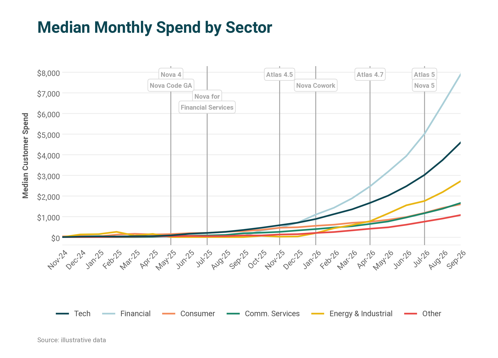

**什么时候用**：读者会问「这个拐点是因为什么」的时候。把模型发布、政策落地、调价、财报日画成竖线，走势和原因在同一张图里对上。

**什么时候别用**：事件超过 8 个（图会被竖线切碎，挑最重要的）；序列超过 6 条（合并或拆图）。

| 参数 | 含义 |
|---|---|
| `x` | 横轴标签列表 |
| `series` | `{名称: 数值列表}`，顺序即重要性，第一条是深青色 |
| `events` | `[{"at": 标签或下标, "label": "文字"}]`，文字里用 `\n` 分成上下两块小牌 |
| `title` `ylabel` `yfmt` `ylim` | 标题、纵轴标题、刻度格式、纵轴范围 |
| `source` `unit` | 左下角来源行（过长自动折成两行）、绘图区左上角的单位 |
| `chip` | `"soft"` 灰色小牌（事件是背景）；`"ink"` 深色小牌（事件是主题） |
| `chip_at` | `"top"` 贴顶（默认）；`"bottom"` 贴底，数据挤在上方时用 |
| `xtick_every` | 每隔几个标签显示一个，日度数据必填 |
| `colors` | 自定义颜色列表，用来保证同一实体跨图同色 |
| `brand` | 右下角署名文字 |
| `eras` | 图上方的时代条，见「通用参数」 |
| `marks` | 虚线框、红叉、贴线小牌、编号圆点，见「通用参数」 |

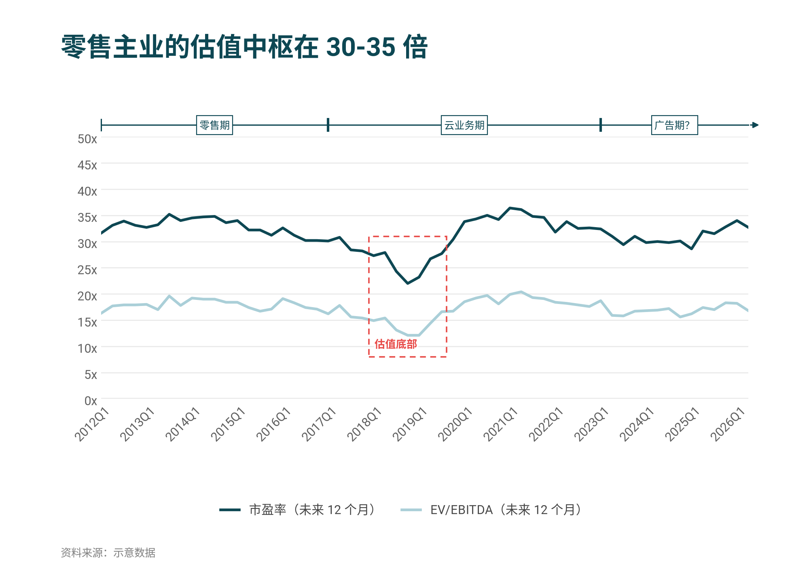

**要点**
- 事件文字控制在 3 个词以内，是名字不是句子。
- 事件竖线回答「哪天发生了什么」，时代条回答「这一段属于哪个时代」。估值倍数、市场份额这类跨越十几年的序列，用时代条比竖线清楚。
- 纵轴故意截断（如价格图只看 0 到 5）时用 `ylim`，冲出去的线会被裁掉，这是允许的，但要在正文说明。
- 序列起点不同（新产品中途才出现）用 `null` 占位，线会从有数据处开始。

---

## 2. `stacked_family` 按家族配色的堆叠柱

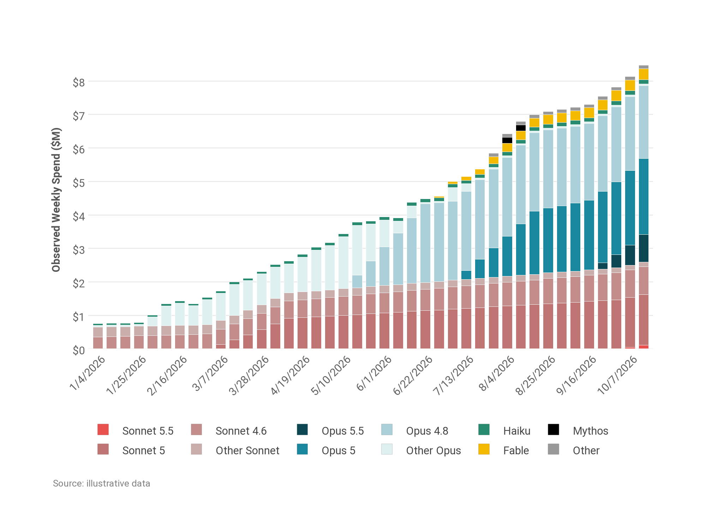

**什么时候用**：总量在涨，同时内部在换代。读者既要看总高度，也要看「新一代吃掉老一代」。

**什么时候别用**：各层没有家族关系（改用普通分类色）；想比较的是各层自身的走势而不是构成（改用线图）。

| 参数 | 含义 |
|---|---|
| `layers` | `{成员: 数值列表}`，按**从下到上**的堆叠顺序写 |
| `families` | `{家族: [成员, …]}`，成员按**从新到旧**写；第一个家族取暖色，第二个取冷色 |
| `minor` | 零散小类列表，取点缀色，建议堆在最上面 |
| `percent` | `true` 时每根柱子归一成 100% |
| `title` `ylabel` `yfmt` `xtick_every` `source` `unit` `brand` | 同画法 1 |
| `colors` | `{成员: 色值}` 个别覆盖 |
| `totals` | `true` 时在每根柱子上方写总量（`percent` 时不写） |
| `marks` | 例如在预测年份上打红叉，见「通用参数」 |

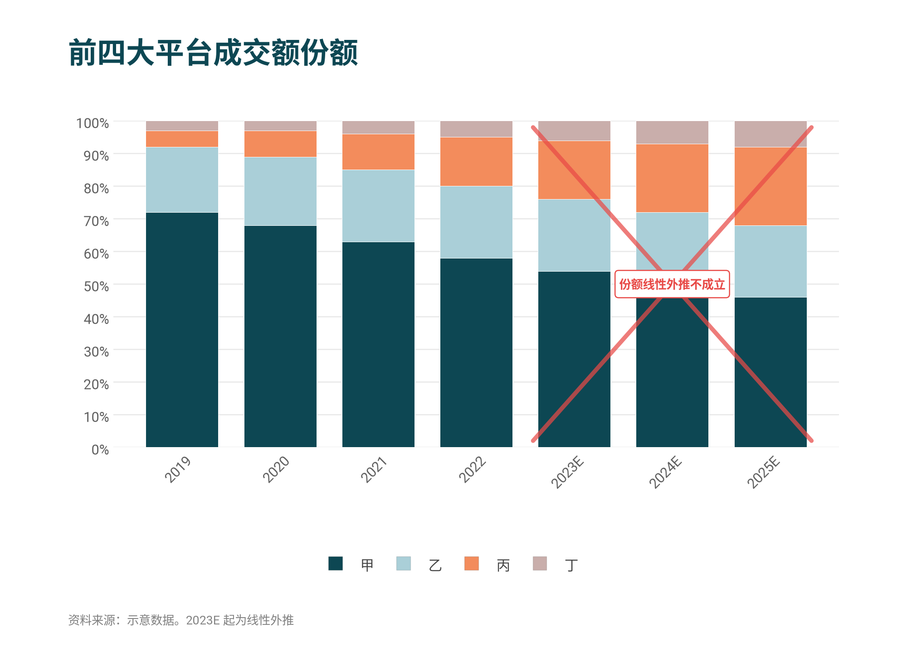

**要点**
- 堆叠顺序：最稳定的家族放底部，变化最大的放中间，零散的放顶上。底部平稳，读者才看得清上面的变化。
- 一个家族最多 4 代。更老的合并成「其他 ××」，用该家族最浅的那一档。
- 图例会按家族分组排列，同族的在一起。

---

## 3. `bar_line` 柱加线双轴图

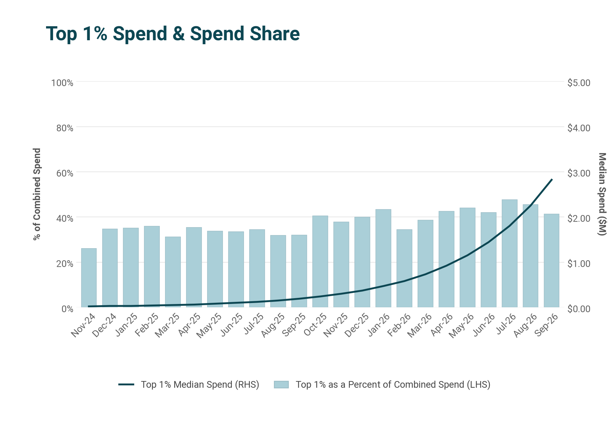

**什么时候用**：一个量看规模，一个量看比率或强度。收入与毛利率、应收与周转天数、占比与金额。

**什么时候别用**：两个量单位相同（画在同一根轴上）；两个量没有因果或对照关系（不要为了省地方硬凑双轴）。

| 参数 | 含义 |
|---|---|
| `x` `bars` `line` | 横轴标签、柱子数值、线的数值（可省略，只画柱） |
| `theme` | `"mono"`（默认，带数据标签）或 `"teal"`（不带标签，适合点数多的月度数据） |
| `bar_name` `line_name` | 图例文字，线的名字里写明「右轴」或 RHS |
| `bar_fmt` `line_fmt` | 数据标签格式 |
| `left_fmt` `right_fmt` `left_ylim` `right_ylim` | 两根轴的刻度格式与范围 |
| `ylabel` `right_label` | 左右纵轴标题（仅 teal 主题） |
| `highlight` | 要上色的柱子（标签或下标，可为列表） |
| `forecast_from` | 从哪个标签起是预测值，之后的柱子变浅 |
| `note` | 图内红字批注，如两段复合增速 |
| `legend` | `"top"`（默认）或 `"bottom"` |
| `title` `source` `unit` `number` | 标题、来源、单位、图号（`number` 仅 mono） |
| `marks` | 见「通用参数」 |
| `notes` `notes_title` | 右侧编号结论栏（仅 mono），见「通用参数」 |

**要点**
- mono 主题下柱不超过 8 根，否则数据标签会挤。点数多就用 teal。
- 不给 `right_ylim` 时，右轴会自动取整并和左轴网格线对齐。自己指定范围时，让左右两轴的格数相同（例如左轴 0 到 800 分 8 格，右轴就取 0 到 160），刻度才会落在同一组网格线上。
- 柱和线都在上升时两者会叠在一起。想把线抬到柱子上方，同时调大 `left_ylim` 的上限（把柱子压到下半部）和 `right_ylim`。代价是柱子的增幅看起来变小，正文里要把倍数写出来。
- 柱顶数值永远在柱子上方；线的数值默认在标记上方，和柱顶数值相撞时自动改到标记下方。
- 增速这种「结论性数字」用 `note` 写进图里，不要让读者自己算。

---

## 4. `panel_grid` 多图联排

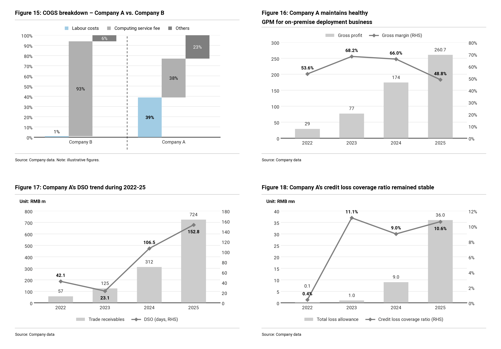

**什么时候用**：一个论点需要三四个不同口径的证据，单独放会把正文冲散。财务质量、单位经济、市场规模这类「一组指标」最合适。

**什么时候别用**：只有两张图（并排放即可，`ncols=2` 配两个面板）；各图之间没有共同主题（那就不该放在一起）。

| 参数 | 含义 |
|---|---|
| `panels` | 面板列表，每个是 `{"kind": …, "title": …, "source": …, "unit": …, 其余为该类型的参数}` |
| `ncols` | 列数，默认 2 |
| `start_number` | 起始图号，自动递增；传 `null` 不编号 |
| `lang` | `"zh"` 强制用「图 N：」，默认按标题语言判断 |

面板类型 `kind`：

| kind | 内容 | 主要参数 |
|---|---|---|
| `bar_line` | 柱加线 | 同画法 3 |
| `bars` | 单色柱，可高亮、可标预测 | `x` `values` `highlight` `forecast_from` `note` `value_fmt` `left_fmt` |
| `cost_steps` | 构成阶梯图：各部分首尾相接逐级上台阶，多组并排对比 | `groups: {组名: [各部分占比]}` `parts: [部分名]` `highlight: 组名` |
| `area` | 堆叠面积 | 同画法 5 |
| `lines` | 主角对照线，线尾直接标名字。`series` 里第一条是藏青（主角），第二条是肉橙（对照），之后是灰 | `x` `series` `yfmt` `ylim` `steps`（阶梯线）`colors` |
| `waterfall` | 拆分瀑布 | 同画法 9 的 `steps` `value_fmt` `highlight` |
| `aligned` | 按发展年份对齐的线 | 同画法 10 的 `series` `xlabel` `yfmt` `labels` |

`bar_line` `bars` `area` `lines` 四种面板都接受 `marks`。几个面板用同一种虚线框圈出同一段时间（例如「下行期」「恢复期」），读者一眼就能把四张图对上：

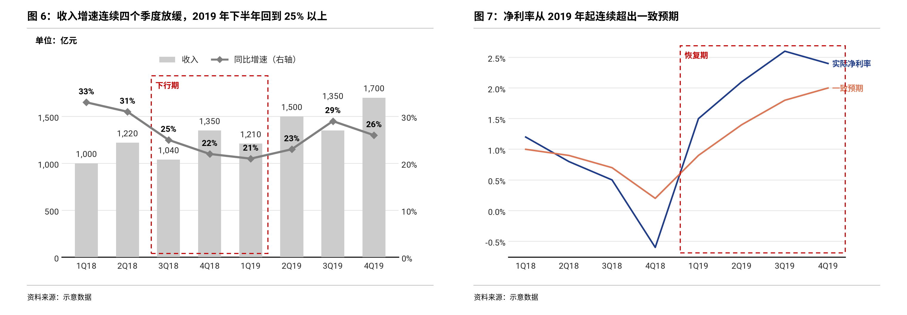

**要点**
- 每个面板的标题仍然是一句结论。四个标题连起来读，应该就是这一节的论证。
- 同一排面板的时间范围尽量一致，读者的眼睛才能横向比。
- 用色按「每个面板」计：一个面板里灰色之外最多两种颜色。`lines` 面板自带藏青和肉橙，不算违规。在此之外，整组图只在最想强调的那一个面板里再加一处高亮或红字批注。
- 面板数取列数的整数倍。三个面板配两列会空出一格，改成 `ncols=3` 或补一张。
- `lines` 面板的纵轴默认不从零开始。指数化的序列（如「2021 年 = 100」）这样画没问题，但要用 `ylim` 让基准值落在刻度上，并在来源行注明。

---

## 5. `area_highlight` 突出一层的堆叠面积图

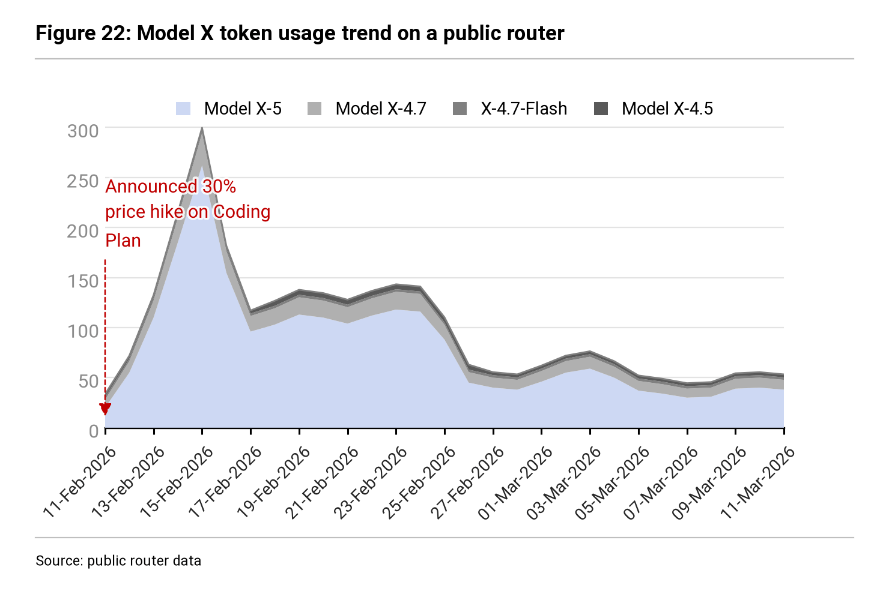

**什么时候用**：形状本身就是信息（冲高、回落、平台），而且总量主要由某一层驱动。面积比柱子更能表现「一波行情」的轮廓。

**什么时候别用**：各层大小相近（没有主角，读者不知道看哪）；数据点少于 8 个（用柱图）。

| 参数 | 含义 |
|---|---|
| `x` `layers` | 横轴标签、`{层名: 数值}`，从下到上 |
| `highlight` | 上色的层，默认第一层 |
| `annotation` | `{"at": 位置, "text": "批注", "y": 箭头落点, "text_y": 文字高度}`，红字加红色虚线箭头 |
| `yfmt` `xtick_every` `title` `source` `unit` `number` | 同前 |
| `marks` `notes` `notes_title` | 见「通用参数」 |

**要点**
- 主角层放最底下，它的上沿就是一条清晰的轮廓线。
- 批注只写一件事，说明「这里发生了什么」，不超过三行。
- 批注文字尽量落在面积较矮的区域，可用 `text_y` 调整。

---

## 6. `scenario_fan` 情景区间图加驱动因素表

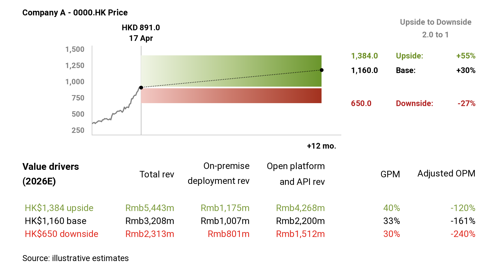

**什么时候用**：给出目标价、预测区间、三种情景时。上半部分回答「可能到哪」，下半部分的表回答「凭什么」。图和表共用绿、黑、红三色，读者不用对照图例就能把数字和情景连起来。

**什么时候别用**：只有一个点预测（没有区间就不需要色带）；情景多于三个。

| 参数 | 含义 |
|---|---|
| `history` | 历史数值，从旧到新 |
| `now` `base` `upside` `downside` | 当前值与三个目标值 |
| `name` `now_label` `horizon_label` | 左上角名称、当前点上方文字（可两行）、右下角期限 |
| `table_title` | 表格左上角文字，如「关键假设\n(2026E)」 |
| `table` | `{"columns": [列名], "rows": {"upside": […], "base": […], "downside": […]}, "row_labels": {…}}` |
| `labels` | 覆盖默认英文：`{"upside": "乐观", "base": "基准", "downside": "悲观", "ratio": "上行/下行空间比"}` |
| `price_fmt` `source` | 数值格式、来源 |

**要点**
- 涨跌幅和空间比由函数自动算，不要手填，避免和图对不上。
- 表格列数 4 到 6 列为宜，列名可用 `\n` 折两行。
- 色带从浅到深表示时间越远，不代表概率。正文里如果给了概率，另行说明。

---

## 7. `capability_ladder` 能力阶梯图

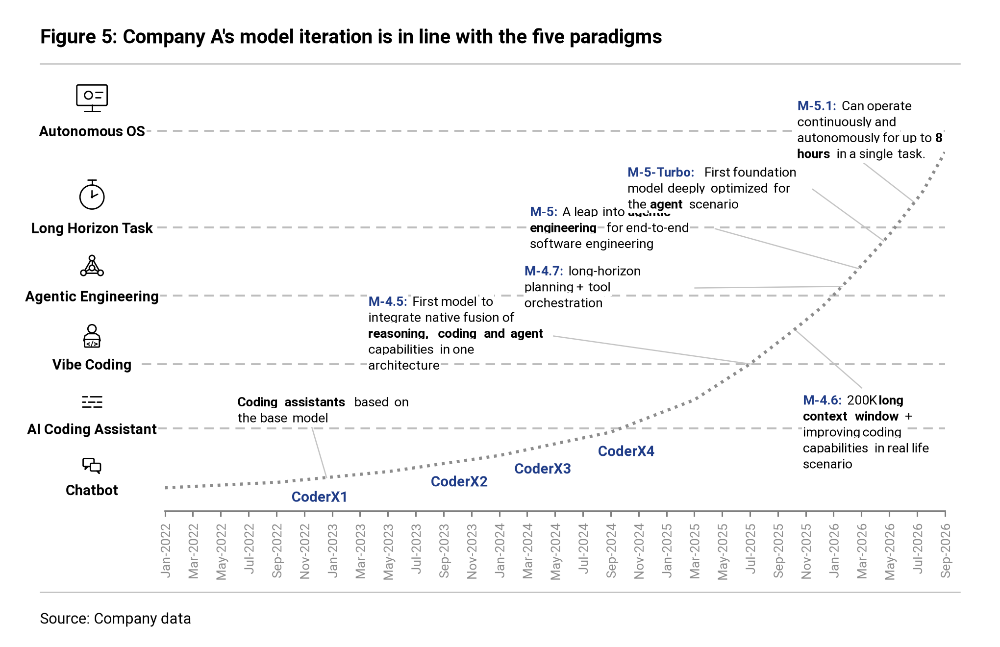

**什么时候用**：讲「从哪一级走到了哪一级」的故事。左侧的图标和虚线把抽象的阶段变成看得见的台阶，点状曲线表示走过的路，每个节点挂一句话说明它跨过了什么。适合产品代际、技术路线、组织成熟度。

**什么时候别用**：纵轴其实是一个可测量的数值（那就老实画线图）；阶段之间没有先后高低。

| 参数 | 含义 |
|---|---|
| `timeline` | 横轴标签 |
| `stages` | `[{"label": 阶段名, "icon": 图标名, "y": 高度}]`，从低到高；`y` 是你自己定的相对高度 |
| `curve` | `[[x, y], …]` 曲线控制点，x 可为标签或小数下标 |
| `milestones` | 节点列表，见下 |
| `accent` | 节点名的颜色，默认藏青 |
| `title` `source` `number` `tick_every` | 同前 |

节点两种写法：
- 只有名字：`{"at": x, "name": "v1"}`，名字贴在曲线旁。
- 带说明：`{"at": x, "name": "v5:", "note": "迈入 **智能体工程**", "text": [x, y], "width": 1.7}`。`text` 是说明文字左上角的位置，`width` 是文字块宽度（英寸），`**…**` 包住的词加粗。函数会自动画一条细引线连到曲线。

可用图标（`--list` 可查）：`chat` 对话、`list` 清单、`coder` 写代码的人、`network` 节点网络、`timer` 秒表、`screen` 显示器、`gear` 齿轮、`doc` 文档、`bars` 柱状图、`db` 数据库、`rocket` 火箭、`target` 靶心。

**要点**
- 相邻阶段的 `y` 至少隔开总高度的 15%，否则图标放不下会被自动省略。
- 说明文字放在曲线的左上方空白处，右下角只放一两个，避免引线交叉。
- 每条说明里只加粗一个短语，就是这一代「新在哪」。
- 画完一定要看图调 `text` 位置，这是唯一需要手工排版的画法。

---

## 8. `phase_trend` 分阶段趋势图

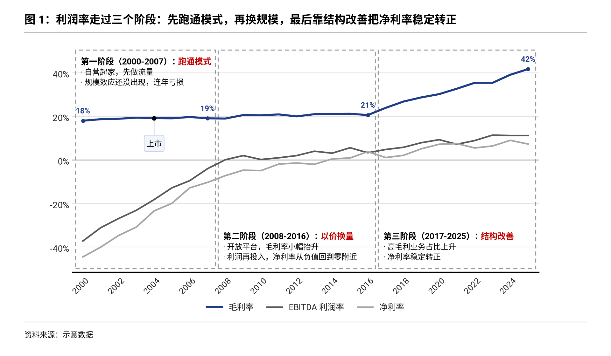

**什么时候用**：一段十年以上的历史，可以清楚地分成两到四个阶段，每个阶段有一句话的定性。利润率三阶段、经营周期、行业格局演变都适合。虚线框把时间切开，框里写「阶段名：定性」和两三条要点，读者不读正文也能把故事讲出来。

**什么时候别用**：阶段划分有争议，或者只是为了好看硬切（那就用 `trend_events` 标几个事件）；阶段超过四个（框太窄，字放不下）。

| 参数 | 含义 |
|---|---|
| `x` `series` | 横轴标签、`{名称: 数值}`。第一条是藏青主线，其余由深到浅的灰 |
| `phases` | `[{"from": 标签, "to": 标签, "name": "第一阶段（2000-2007）：", "verdict": "跑通模式", "notes": ["…", "…"], "pos": "auto"}]` |
| `labels` | `"phase_ends"`（默认，主线在每个阶段末尾标数）、`"ends"`（只标首尾）、`null` |
| `label_fmt` `yfmt` `ylim` | 数据标签格式、纵轴格式与范围 |
| `box_color` | 阶段框颜色，默认灰。想更醒目可用琥珀色 `#E0A526`，全篇统一 |
| `eras` `marks` | 见「通用参数」 |
| `title` `source` `unit` `number` `xtick_every` | 同前 |

**要点**
- `name` 用黑色加粗，`verdict` 用警示红，放得下时排在同一行。定性控制在 6 个字左右，像「跑通模式」「以价换量」「结构改善」。
- 每个阶段最多三条要点，每条一行。写不下说明要点太细，挪到正文。
- 文字自动放在框里数据较少的那一半（上或下），并自动留出纵轴空间。个别阶段放错了，用 `pos` 指定 `"top"` 或 `"bottom"`。
- 不要每个点都标数。研报图表最常见的毛病就是数据标签挤成一片，阶段末尾的数字已经足够说明「这一段走到了哪」。

---

## 9. `waterfall` 拆分瀑布图

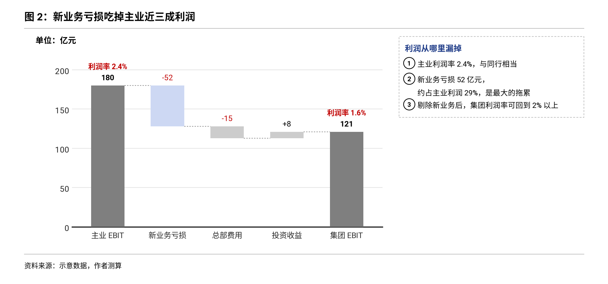

**什么时候用**：从一个总数走到另一个总数，中间每一步加了多少、减了多少。主业利润到集团利润、收入到自由现金流、去年利润到今年利润的变化归因。

**什么时候别用**：各部分之间是并列构成而不是先后加减（用堆叠柱或 `cost_steps` 面板）；步骤超过 8 步（合并小项）。

| 参数 | 含义 |
|---|---|
| `steps` | `[{"label": "主业 EBIT", "value": 180, "kind": "total", "tag": "利润率 2.4%"}, {"label": "新业务亏损", "value": -52}, …, {"label": "集团 EBIT", "kind": "subtotal"}]` |
| `kind` | `"delta"`（默认，增减项）、`"subtotal"`（到此为止的累计，不用填数）、`"total"`（给定总数，或不填数取累计） |
| `tag` | 写在柱顶数字上方的红字，常用来标利润率 |
| `highlight` | 要上色的步骤名（可为列表）。增减项用淡紫蓝，总数用藏青 |
| `value_fmt` `connectors` `note` | 数字格式、是否画虚线连接、图内红字批注 |
| `marks` `notes` `notes_title` | 见「通用参数」 |
| `title` `source` `unit` `number` | 同前 |

**要点**
- 总数柱深灰，增减项浅灰，减项的数字用警示红。只给最想让读者看的那一步上色。
- 首尾两根总数柱用 `tag` 写出利润率，读者能直接看到「利润率从 2.4% 掉到 1.6%」。
- 小计（`subtotal`）由函数自动算，不要手填，避免和前面的增减对不上。

---

## 10. `aligned_compare` 按发展年份对齐

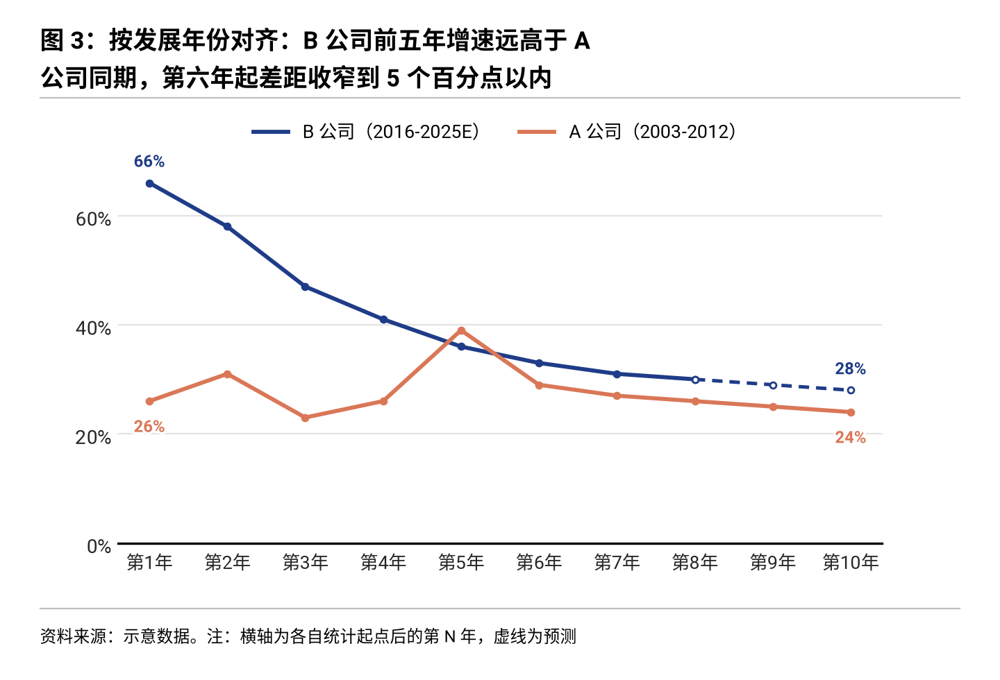

**什么时候用**：拿一家公司和另一家「当年的它」比。两家公司所处年代不同，按日历年放在一起没法比，把各自的起点都对齐成第 1 年，比的是同一发展阶段。

**什么时候别用**：两家公司本来就在同一时期竞争（直接用日历年，`lines` 面板即可）；起点的选法有争议（先在正文说清楚为什么从这一年算起）。

| 参数 | 含义 |
|---|---|
| `series` | `{"B 公司": {"start": 2016, "values": […], "forecast_from": 2024}, "A 公司": {"start": 2003, "values": […]}}` |
| `start` | 起始年份。图例会自动写成「B 公司（2016-2025E）」，保留真实年份 |
| `periods` | 期间不是整年时（如 `["FY11", …]`）用它代替 `start` |
| `forecast_from` | 从哪一年起是预测，之后画虚线、图例年份带 E |
| `xlabel` | 刻度文字，默认 `"Y{n}"`，中文用 `"第{n}年"` |
| `labels` | `"ends"`（默认，标首尾）、`"all"`、`null` |
| `yfmt` `value_fmt` `ylim` `colors` | 同前 |
| `marks` `notes` `notes_title` | 见「通用参数」 |

**要点**
- 来源行里写一句「注：横轴为各自起点后的第 N 年」，并在正文交代起点为什么这么选（上市、业务分拆、某项业务开始披露）。
- 第一条藏青是主角，第二条肉橙是对照。不要超过三条。
- 纵轴全为正且最小值离零不远时，从零开始。

---

## 11. `process_cost` 流程加成本柱

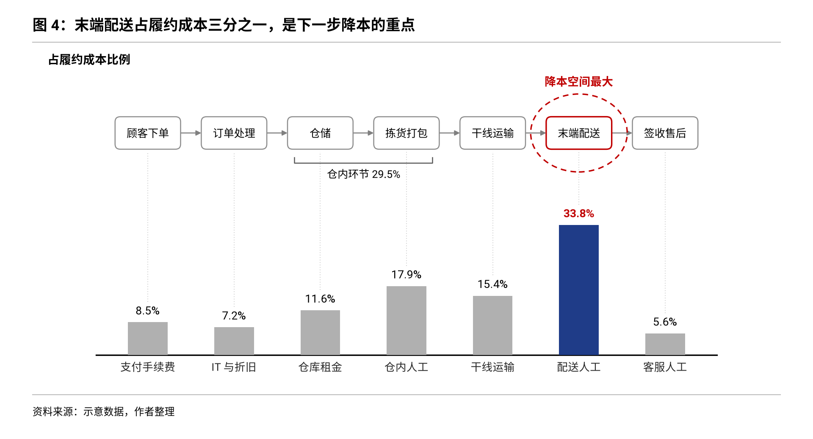

**什么时候用**：讲一个业务的流程，同时要说钱花在哪个环节。上面一排方框是流程，下面的柱子对齐到对应环节，红色虚线圈住成本最大或优化空间最大的那一环。履约、获客、生产、交付都可以这样画。

**什么时候别用**：成本项和流程环节对不上（那就分成一张流程图和一张柱图）；环节超过 8 个。

| 参数 | 含义 |
|---|---|
| `steps` | `[{"label": "顾客下单", "cost": 8.5, "cost_label": "支付手续费"}, …]`，没有成本的环节不填 `cost` |
| `groups` | `[{"from": "仓储", "to": "拣货打包", "text": "仓内环节 29.5%", "row": "steps"}]`，`row` 为 `"bars"` 时括号画在柱子上方 |
| `highlight` `highlight_text` | 要圈出的环节名、圈旁的红字 |
| `value_fmt` | 柱顶数字格式，默认一位小数百分比 |
| `title` `source` `unit` `number` | 同前 |

**要点**
- 只圈一个环节。圈两个就等于没圈。
- 柱子不画纵轴，数值直接写在柱顶。单位用 `unit` 写清楚是「占比」还是金额。
- 方框里的字是环节名，四到六个字。

---

## 12. `share_compare` 结构对比加编号旁注

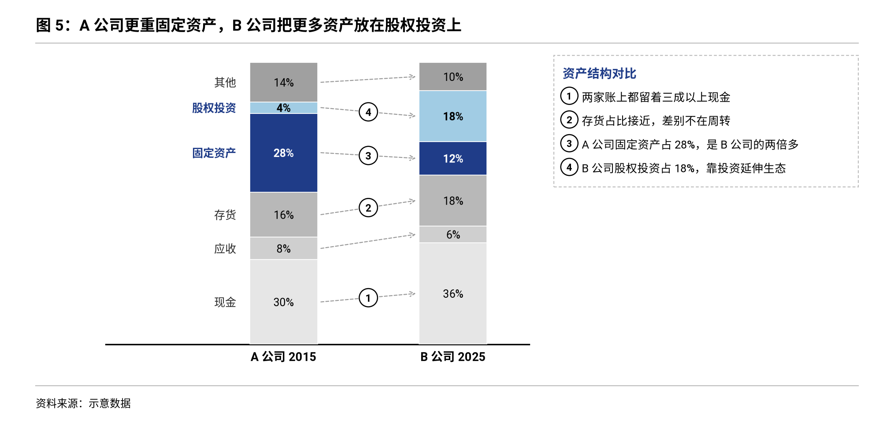

**什么时候用**：比较两三个主体的结构，例如两家公司的资产负债表、收入构成、成本构成。同一项用虚线箭头连起来，在箭头上放编号圆点，右侧旁注按编号逐条写结论。图、结论、编号三者对上，读者不用来回找。

**什么时候别用**：只想看某一项的大小（用柱图）；超过四个主体（改成表格）。

| 参数 | 含义 |
|---|---|
| `columns` | `{"A 公司 2015": […], "B 公司 2025": […]}`，数值从下到上，自动归一成 100% |
| `parts` | 各部分名称，从下到上 |
| `highlight` | 要上色的部分（最多两个，第一个藏青、第二个天蓝） |
| `numbers` | `{部分名: 编号}`，编号圆点放在该部分的连线上 |
| `notes` `notes_title` | 右侧旁注，按顺序编号 1、2、3… |
| `links` | `true`（默认，全部连线）、`"marked"`（只连上色和编号的部分）、`false` |
| `value_fmt` `min_label` | 格子里数字的格式、小于多少不写数字 |
| `title` `source` `unit` `number` | 同前 |

**要点**
- 部分名直接写在第一根柱子左边，不用图例。
- 旁注每条一句，先说事实再说含义：「A 公司固定资产占 28%，是 B 公司的两倍多」。
- 编号顺序按阅读顺序排，不必按柱子从下到上。

---

## 通用参数：强调记号、时代条、旁注

### `marks` 强调记号

`trend_events` `stacked_family` `bar_line` `area_highlight` `phase_trend` `waterfall` `aligned_compare` 七个画法，以及 `bar_line` `bars` `area` `lines` `waterfall` `aligned` 六种面板，都接受 `marks` 列表。位置用横轴标签或下标。

| 写法 | 画出来是什么 | 什么时候用 |
|---|---|---|
| `{"type": "box", "from": x, "to": x, "y": [下, 上], "text": "估值底部", "text_at": "top"}` | 红色虚线框，左上角一句红字 | 圈出读者该看的那一段。不给 `y` 就是整列高 |
| `{"type": "cross", "from": x, "to": x, "text": "线性外推不成立"}` | 红叉，中间一块白底红字 | 否定一种外推或一个常见误解 |
| `{"type": "pin", "at": x, "series": 名称, "text": "上市", "dy": -22}` | 曲线上一个点加一块小牌 | 把融资、上市、回购这类事件直接贴在股价或指标线上。`dy` 为负时小牌在下方 |
| `{"type": "num", "at": x, "y": 数值, "n": 1}` | 编号圆点 | 和 `notes` 的第 n 条对应 |

规则：一张图最多一个虚线框或一个红叉；红字一句话，十个字以内。

### `eras` 时代条

`trend_events` 和 `phase_trend` 接受 `eras`：`[{"from": x, "label": "零售期"}, {"from": x, "label": "云业务期"}, {"from": x, "label": "广告期？", "open": true}]`。每个时代持续到下一个时代开始；最后一个持续到 `to` 或横轴末尾，`open` 为真时末端画箭头。

最后一个时代名带问号，是在提出这份报告要回答的问题。后文给出答案时，用同一张图、去掉问号再放一次（见 `writing-rhythm.md`「首尾呼应」）。

### `notes` 旁注栏

mono 主题的 `bar_line`、`area_highlight`、`waterfall`、`aligned_compare`、`share_compare` 接受 `notes`（字符串列表）和 `notes_title`。图的右侧会多出一栏，每条前面有编号圆点，和图上的 `num` 记号或 `share_compare` 的 `numbers` 对应。画布会自动加宽，图本身的大小不变。

- 旁注最多四五条，每条不超过两行。
- 旁注写结论，不写图上已经看得到的数字罗列。

---

## 常见错误

| 现象 | 原因和改法 |
|---|---|
| 中文是方框 | 没装中文字体。运行 `--fonts` 检查，装 Noto Sans SC |
| 横轴标签糊成一片 | 加 `xtick_every` |
| 事件小牌叠了五六层 | 事件太密。删掉次要的，或把相邻两个合并成一块两行的小牌 |
| mono 图看起来「没重点」 | 没有任何高亮。用 `highlight` 或 `note` 指出一处 |
| mono 图看起来「很花」 | 颜色超过两种。把非主角的改回灰色 |
| 双轴图线压在柱子上看不清 | 同时调 `left_ylim` 和 `right_ylim`，见画法 3 的要点 |
| 报错 `unknown key(s)` | 规格里有该画法不认识的键。报错信息里列出了全部可用的键 |
| 标题太长顶到右边 | 标题会自动折成两行。超过两行说明标题不是一句话，回去改标题 |
| 阶段框里的字放不下 | 阶段太短或要点太长。合并阶段，或把要点缩成一行 |
| 旁注提示 overflow | 旁注太多或太长。删到四条以内，每条一句 |
| 贴线小牌压住了别的字 | 用 `dy` 把小牌换到曲线另一侧，或用 `dx` 左右挪 |
